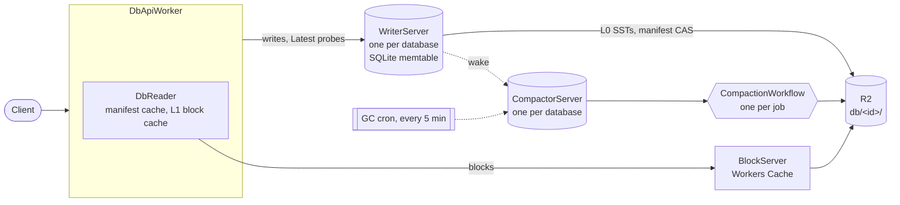
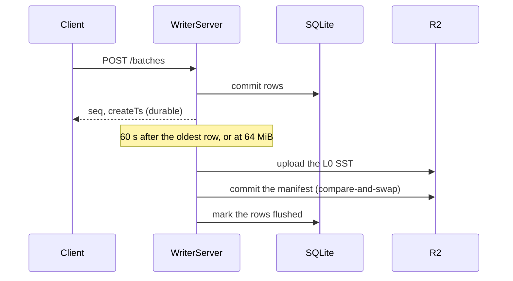
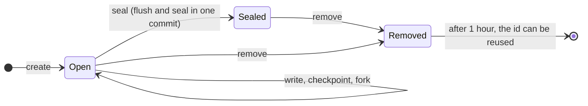

<p align="center">
  
</p>

<h1 align="center">shaledb</h1>

<p align="center">A log-structured merge tree key-value store on Cloudflare Durable Objects, R2, and Workflows.</p>

<p align="center">
  <a href="https://shaledb.mulroy.workers.dev">How it works</a> ·
  <a href="#quick-start">Quick start</a> ·
  <a href="docs/openapi/shaledb-v1.json">API contract</a> ·
  <a href="docs/measurements.md">Measurements</a> ·
  <a href="docs/invariants.md">Invariants</a>
</p>

- **Writes are durable when the call returns.** Each database has one writer Durable Object, and its SQLite table is the write-ahead log and the memtable.
- **Data lives in R2, not in the Durable Object.** The writer flushes immutable SSTs to R2, and a Cloudflare Workflow compacts them.
- **Reads scale with readers.** Every read except `Latest` runs in the caller's Worker and never touches the writer.
- **Databases are cheap to copy and split.** A fork or a range split references the source's SSTs and copies no data.

```sh
# Write a row to the database `orders`, then read it back. Keys and values are base64.
curl -X POST localhost:1337/v1/databases/orders/batches -H 'content-type: application/json' \
  -d '{"operations":[{"_tag":"Put","key":"dXNlcjo0Mg==","value":"QWRh","ttlMillis":null}]}'
# {"seq":1,"createTs":1764230400000}

curl -X POST localhost:1337/v1/databases/orders/get -H 'content-type: application/json' \
  -d '{"key":"dXNlcjo0Mg==","consistency":{"_tag":"Latest"},"snapshot":null}'
```

shaledb follows [SlateDB](https://slatedb.io)'s model, one writer and many readers, immutable SSTs, a manifest versioned by compare-and-swap, size-tiered compaction, and replaces two parts of it with Cloudflare ones: the writer is a Durable Object, and compaction is a Workflow.

## Contents

- [How it fits together](#how-it-fits-together)
- [Writes](#writes)
- [Reads](#reads)
- [Background work](#background-work)
- [Database lifecycle](#database-lifecycle)
- [Who it is for](#who-it-is-for)
- [Compared with a plain Durable Object table](#compared-with-a-plain-durable-object-table)
- [Quick start](#quick-start)
- [The API](#the-api)
- [Repository](#repository)
- [Verifying a change](#verifying-a-change)
- [Documentation](#documentation)

## How it fits together

The unit is a **database**: one id with its own writer, its own compactor, its own manifest chain, and everything it stores under `db/<id>/` in R2.



The [interactive guide](https://shaledb.mulroy.workers.dev) animates every request path through this diagram, simulates the timers, and lists every endpoint with its call tree.

## Writes

A write commits to the writer's SQLite table and returns. A flush later uploads the unflushed rows to R2 as one L0 SST and commits a new manifest.



Every manifest is written with put-if-absent, so two writers can never both commit the same version. Each start of a writer increments its epoch in the manifest, so a commit from an older instance fails. A crash between the upload and the commit leaves an SST that no manifest references, and garbage collection deletes it. [`docs/invariants.md`](docs/invariants.md) lists every such case, with the tests and TLA+ models that check it.

One database's write rate is bounded by its writer, which commits one batch at a time. Every measured number here names the commit it was measured on; none is yet on the release commit.

<!-- STEP4 readme-writes: begin -->

Measured on `preview-3`, production settings, 100% trace sampling, commit `d89beba` (provisional: not the release commit); 16-byte keys and 100-byte values, from a laptop on a US residential connection, so latencies include an internet round trip:

| Batch rows | Batches in flight | Rows/s acknowledged | Client latency p50 / p90 / p99 (ms) | Writer busy |
| ---------- | ----------------- | ------------------- | ----------------------------------- | ----------- |
| 100        | 8                 | 4,394               | 146 / 273 / 539                     | 0.52        |
| 1,000      | 16                | 22,359              | 596 / 1,187 / 2,465                 | 0.7         |

Writer busy below 1 means these are the rates measured, not a proven ceiling ([`docs/measurements.md`](docs/measurements.md), "Step 4").

<!-- STEP4 readme-writes: end -->

## Reads

Reads run in the caller's Worker. The consistency level decides whether a read asks the writer:

```text
get(key, consistency)
  if a snapshot is given      read at the snapshot             # never asks the writer
  if consistency is Flushed   read the cached manifest         # may lag the newest flush by about 1 s
  if consistency is AtLeast   read the cached manifest if it covers seq, else ask the writer
  if consistency is Latest    ask the writer for unflushed versions, then read the manifest
```

- **`Latest`** sees every acknowledged write. Every `Latest` read of a database costs that database's writer one probe, and pays the network distance to it. The probe took 10 ms at p50.
- **`AtLeast`, `Flushed`, snapshots, and scans of flushed data** never load the writer, so they scale with readers. A `Flushed` read may miss writes that are not flushed yet, for up to a minute.

Block bytes come from the isolate's L1 cache, then Workers Cache, then R2. Read latencies are in [`docs/measurements.md`](docs/measurements.md), "Read latency".

A scan page stops at its limit or after examining 16 MiB of versions, so a page may hold fewer rows than asked, or none. Follow `resumeFrom` until it is null:

```text
start = range.start
loop
  page = scan(range from start)
  use page.rows
  if page.resumeFrom is null: done
  start = page.resumeFrom
```

A transaction's commit must name the whole range it scanned in `readRanges`. The commit checks only the ranges it is sent, so naming just the rows the pages returned lets a conflicting write beyond the last page pass unseen.

## Background work

Nothing polls. Every periodic process is a Durable Object alarm, a cron, or a Workflow, and an idle database has no alarm set.

| Process            | Trigger                                                         | Does                                                              |
| ------------------ | --------------------------------------------------------------- | ----------------------------------------------------------------- |
| Flush              | Writer alarm: 60 s after the oldest unflushed row, or at 64 MiB | Uploads an L0 SST and commits the manifest                        |
| Compaction         | Compactor alarm, every 5 s while there is work                  | Plans size-tiered jobs of 4 to 8 SSTs and runs each as a Workflow |
| Garbage collection | Compactor alarm, 1 hour after a job finishes                    | Deletes SSTs and manifests that nothing references                |
| Maintenance sweep  | Cron, every 5 minutes, 50 databases per run                     | Cleans up removed databases and repairs lost wakes                |

## Database lifecycle

Every lifecycle change is a manifest compare-and-swap.



A **fork** creates a new database from a checkpoint and a key range. It references the source's SSTs, copies nothing, and holds the source until its own compactions have rewritten them. Range sharding (`packages/lsm-sharding`) splits one key space across databases with a seal and two forks.

## Who it is for

shaledb is for many independent writers spread across many databases, not one global hot writer. Throughput grows by adding databases, and, for one key space, by splitting it with range sharding.

One database holds at most about 312 GiB. Past that, a compaction of the whole database outgrows what one Workflow may run. This is derived, not measured: the largest compaction run live was about 0.5 GiB. Long keys lower the limit, because the manifest lists every SST's first and last key. Every limit a caller can meet is in [`docs/api-compatibility.md`](docs/api-compatibility.md), "Limits of v1".

It is not a fit for:

- one hot key range that needs more than one writer's throughput, without range sharding;
- atomic writes or transactions across databases: batches and transactions are atomic within one database;
- `Latest` reads under 10 ms from far away: with the writer in the EU and the API Worker in the US, a `Latest` get took about 130 ms at p50;
- anything [`docs/measurements.md`](docs/measurements.md) does not cover. Its "Not measured" list names what is open.

## Compared with a plain Durable Object table

<!-- STEP4 readme-baseline: begin -->

The same workload against shaledb and against one table in a plain Durable Object, on `preview-3` (production settings, 100% trace sampling), from the same client, one target after the other, each on a new database or object. Median of 3 of 3 runs, commit `d89beba` (provisional: not the release commit).

| Target                      | Rows/s acknowledged | Write p50 / p99 (ms) | Reads/s | Read p50 / p99 (ms) | Cost per million rows written |
| --------------------------- | ------------------- | -------------------- | ------- | ------------------- | ----------------------------- |
| shaledb, reads at `Latest`  | 5,860               | 115 / 520            | 61.6    | 110 / 699           | $3.02                         |
| shaledb, reads at `Flushed` | 5,839               | 126 / 367            | 120.9   | 48 / 212            | $3.03                         |
| plain Durable Object SQLite | 6,991               | 100 / 397            | 76      | 94 / 362            | $1.01                         |

- **Write p50:** 115 ms (`Latest` run), 126 ms (`Flushed` run), 100 ms (plain table).
- **Read p50:** 110 ms at `Latest`, 48 ms at `Flushed`, 94 ms from the plain table.
- **Durable Object invocations at `Flushed`:** 1,741 in the tail records, against 1,757 write batches: no more than the writes, which is what reads that never reach a Durable Object give. It does not prove it: tail records can be dropped, so the count is a lower bound.
- **SQLite rows written per row:** 3 for shaledb's memtable, 1 for the plain table.

Each target's runs, the stage-side counts, and the price arithmetic are in [`docs/measurements.md`](docs/measurements.md), "Step 4".

<!-- STEP4 readme-baseline: end -->

- **Data leaves the Durable Object.** A plain table lives inside one object's SQLite storage, with its size limit and storage price. shaledb's flushed data is in R2.
- **Reads do not load the writer.** A `Flushed` read runs in the API Worker and asks no Durable Object.
- **Forks, checkpoints, pinned snapshots, and splits** have no counterpart in a plain table. Their costs are measured separately and are not in this comparison.
- **Not measured here:** storage cost over time, a dataset near a Durable Object's storage limit, readers in other regions, and more than 8 clients.

If one Durable Object's table holds the data and its writer can serve every read, the plain table is simpler and cheaper to write to.

## Quick start

Requirements: Node 24 and [Vite+](https://viteplus.dev) (`vp`).

```sh
vp install
vp run dev                                    # the whole Stack on local R2, Durable Objects, and Workflows
node tools/trace-cli/src/trace-cli.ts serve   # optional: receive every span on 127.0.0.1:4318
```

The API is at `http://localhost:1337/v1`. Local stages need no token. Create a database, then write and read:

```sh
curl -X POST localhost:1337/v1/databases -H 'content-type: application/json' \
  -d '{"databaseId":"orders","keyRange":null,"mergeOperator":null,"changelogRetentionMs":null,"budgetGroup":null}'
curl -X POST localhost:1337/v1/databases/orders/batches -H 'content-type: application/json' \
  -d '{"operations":[{"_tag":"Put","key":"dXNlcjo0Mg==","value":"QWRh","ttlMillis":null}]}'
curl -X POST localhost:1337/v1/databases/orders/get -H 'content-type: application/json' \
  -d '{"key":"dXNlcjo0Mg==","consistency":{"_tag":"Latest"},"snapshot":null}'
```

`node tools/scenario-cli/src/scenario-cli.ts run all` runs every end-to-end scenario against the local Stack, with trace assertions.

## The API

The contract is [`docs/openapi/shaledb-v1.json`](docs/openapi/shaledb-v1.json), generated from `DbHttpApi`, with an example of every request and response.

| Area         | Endpoints                                                                         |
| ------------ | --------------------------------------------------------------------------------- |
| Databases    | create, status, remove                                                            |
| Writes       | batches of puts, deletes, and merges, each with an optional TTL; flush            |
| Reads        | get and scan at `Latest`, `AtLeast`, or `Flushed`; snapshots; pinned snapshots    |
| Transactions | `Snapshot` or `SerializableSnapshot` isolation, with conflicts detected at commit |
| Change feed  | committed changes in sequence order, when the database's changelog is on          |
| Lifecycle    | checkpoints, forks of a key range, seal                                           |
| Repair       | compaction status, and dropping an SST that compaction reported corrupt           |

Every response carries `x-request-id`, and every error shares one envelope:

```json
{ "code": "...", "message": "...", "details": {}, "requestId": "...", "retryable": false }
```

A few behaviors to know:

- **TTLs are judged by the reader's clock.** Readers on different machines may disagree for up to their clock skew. A snapshot fixes which writes are visible, not the time TTLs are judged at.
- **A removed database's id** can be created again one hour after the removal.
- **The change feed** answers `Expired` rather than skip changes that retention dropped. A fork's feed starts at its fork point.

Live stages require `Authorization: Bearer <token>`. [`docs/api-compatibility.md`](docs/api-compatibility.md) states what `/v1` promises.

## Repository

```text
packages/
├── lsm-core/         # pure LSM logic: codecs, Bloom filters, merge iterator, manifest edits, scheduler
├── lsm-cloudflare/   # the engine: writer, reader, compactor, Workflow, GC, lifecycle, HTTP APIs
└── lsm-sharding/     # optional range sharding over the public API
infra/
├── shaledb/          # the Alchemy Stack: buckets, Durable Objects, Workers, the Workflow
└── docs-site/        # the interactive guide at shaledb.mulroy.workers.dev
tools/                # trace CLI, scenario CLI, preview CLI, writer benchmark, TLA+ models
```

`lsm-core` has no Cloudflare imports, and `tools/workspace-boundaries` enforces it.

## Verifying a change

```sh
vp run ready    # format, lint, type checks, and every workspace's tests (unit, property, workerd)
vp run verify   # every TLA+ model, including its deliberately broken variants
```

A release is also gated by `scenario-cli soak` on a preview stage: mixed writes, reads, scans, transactions, the change feed, splits, removals, and a redeploy, checked against a model of every acknowledged write. See [`docs/testing.md`](docs/testing.md).

## Documentation

- [Interactive guide](https://shaledb.mulroy.workers.dev): every process, path, and timer, animated
- [`docs/invariants.md`](docs/invariants.md): what makes a write acknowledged and flushed, what each read may see, and when GC may reclaim an SST
- [`docs/operations.md`](docs/operations.md): deploying, rolling back, tokens, telemetry, and the corruption runbook
- [`docs/measurements.md`](docs/measurements.md): throughput, latency, and limits measured on live stages
- [`docs/design-decisions.md`](docs/design-decisions.md): every judgment call the design did not make
- [`docs/testing.md`](docs/testing.md), [`docs/coding-standards.md`](docs/coding-standards.md), [`docs/errors.md`](docs/errors.md): how to change it
